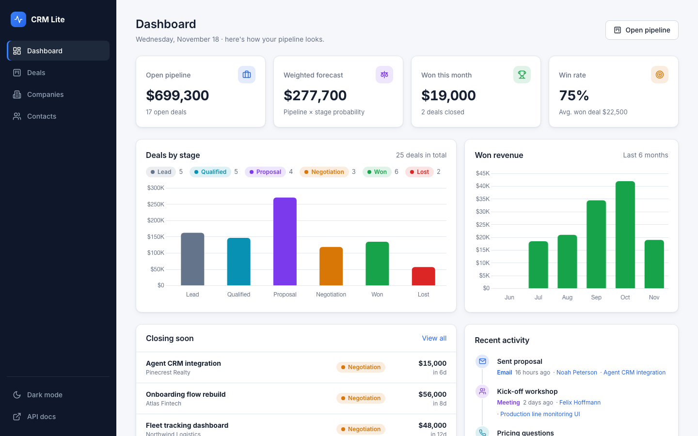
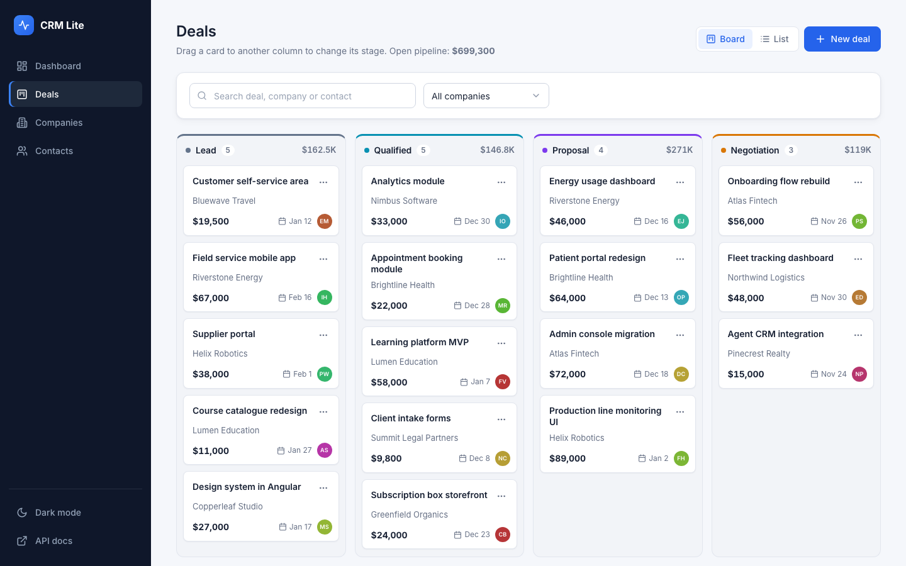
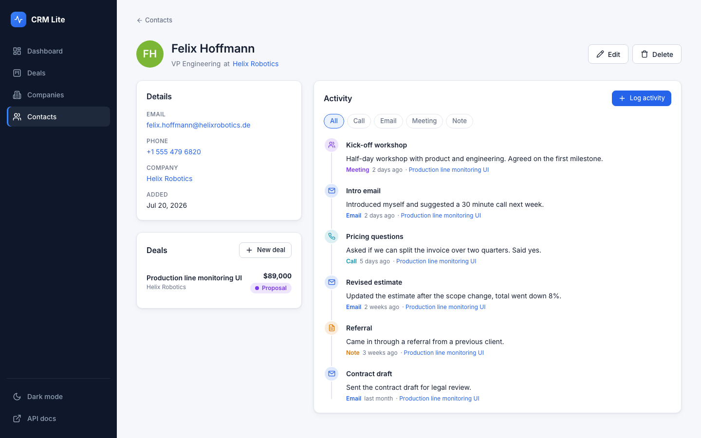
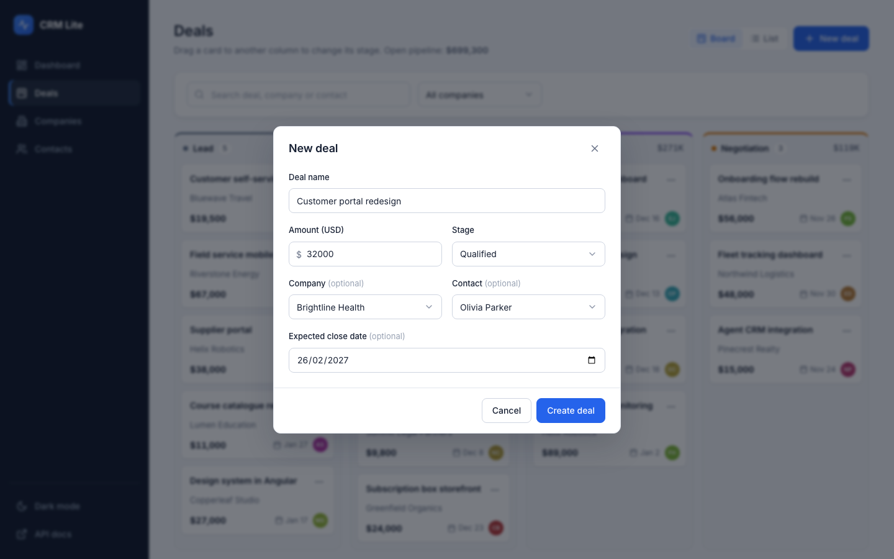

# CRM Lite

A small, fast CRM for freelancers and small sales teams: contacts, companies, a drag-and-drop deals pipeline and an activity timeline, built with Angular 21 and FastAPI.

**Live demo (runs on mock data in the browser): https://hkhodkar.github.io/crm-lite/**



| Deals pipeline | Contact with activity timeline |
| --- | --- |
|  |  |

## Features

- **Deals pipeline** - kanban board with Lead → Qualified → Proposal → Negotiation columns plus Won / Lost lanes. Drag a card to change its stage (saved right away, rolled back if the API fails) or use the card menu, which also works on touch devices
- **List view** - every deal in a sortable, paginated table with stage, status, company and search filters
- **Contacts and companies** - create, edit and delete, with detail pages that show the people, deals and history of an account
- **Activity timeline** - log calls, emails, meetings and notes on a contact or deal, filter them by type, edit or remove them later
- **Dashboard** - open pipeline value, weighted forecast, won this month, win rate, deals by stage, won revenue per month, deals closing soon and recent activity
- **Server-side filtering** - search, filters, sorting and pagination are query params on the API and in the URL, so filtered views can be bookmarked
- **Validation on both sides** - typed reactive forms in the UI, Pydantic rules in the API (email format, unique email, positive amounts, valid stages)
- **Demo data** - 12 companies, 40 contacts, 25 deals and 60 activities are loaded when the database is empty
- **Dark mode** and a responsive layout that works down to phone width



## Tech Stack

**Frontend**

- [Angular 21](https://angular.dev) - standalone components, signals, `computed` / `linkedSignal`, `rxResource`, new control flow, zoneless change detection, OnPush everywhere
- Typed reactive forms, lazy-loaded routes, router input binding for query params
- [Angular CDK](https://material.angular.dev/cdk) drag and drop and overlay
- [Chart.js](https://www.chartjs.org/) through a small directive
- Custom SCSS with CSS variables for light and dark themes
- [Vitest](https://vitest.dev/) for unit tests

**Backend**

- [FastAPI](https://fastapi.tiangolo.com/) with Pydantic v2
- SQLAlchemy 2 with SQLite
- pytest with an in-memory database

**Tooling**

- Docker Compose (nginx serves the Angular build and proxies `/api` to FastAPI)
- GitHub Actions running backend and frontend tests on every push, and deploying the demo build to GitHub Pages

## Getting Started

### With Docker

```bash
git clone https://github.com/hkhodkar/crm-lite.git
cd crm-lite
docker compose up --build
```

- App: http://localhost:8080
- API docs: http://localhost:8000/docs

Data is kept in a Docker volume. Run `docker compose down -v` to start over with fresh demo data.

### Local development

Requirements: Python 3.12+, Node.js 20.19+ or 22.12+.

Backend:

```bash
cd backend
python -m venv .venv
source .venv/bin/activate        # Windows: .venv\Scripts\activate
pip install -r requirements-dev.txt
uvicorn app.main:app --reload
```

The API runs on http://localhost:8000 and creates `crm.db` with demo data on first start.

Frontend (in a second terminal):

```bash
cd frontend
npm install
npm start
```

Open http://localhost:4200. The dev server proxies `/api` to the backend (see `proxy.conf.json`).

### Demo mode

The frontend can run without the backend. In demo mode every `/api` call is answered by a small mock API inside the app (`frontend/src/app/core/mock`): an HTTP interceptor backed by an in-memory copy of the demo data. It follows the same rules as FastAPI (search, filters, sorting, paging, pipeline grouping, dashboard numbers, validation errors and 404s), and changes are kept in `localStorage`, so they survive a reload. The banner at the top shows when demo mode is on and has a **Reset data** button.

- `npx ng build --configuration demo` always uses the mock. This is the build deployed to GitHub Pages by `.github/workflows/deploy.yml`.
- A normal build talks to the real API. If no API answers (the server is down, or a static host returns its own 404 page), the app switches to demo mode for the rest of the session.

To try the demo build locally: `npx ng serve --configuration demo`.

### Tests

```bash
cd backend && pytest                       # API tests
cd frontend && npm test -- --watch=false   # unit tests
```

### Configuration

The backend reads a few environment variables:

| Variable | Default | |
| --- | --- | --- |
| `DATABASE_URL` | `sqlite:///./crm.db` | SQLAlchemy database URL |
| `SEED_DEMO_DATA` | `true` | load demo data when the database is empty |
| `CORS_ORIGINS` | `http://localhost:4200` | comma separated list of allowed origins |

## API

Interactive docs (Swagger UI) are at **http://localhost:8000/docs**. The main endpoints:

| Method | Path | |
| --- | --- | --- |
| `GET` | `/api/companies` | list with `search`, `industry`, `sort`, `page`, `page_size` |
| `GET` | `/api/contacts` | list with `search`, `company_id`, `sort`, paging |
| `GET` | `/api/deals` | list with `search`, `stage`, `status`, `company_id`, `contact_id`, `min_amount`, `max_amount`, `sort`, paging |
| `GET` | `/api/deals/pipeline` | deals grouped by stage for the board |
| `PATCH` | `/api/deals/{id}/stage` | move a deal to another stage |
| `GET` | `/api/activities` | timeline for a `contact_id`, `deal_id` or `company_id`, filter by `type` |
| `GET` | `/api/stats/dashboard` | KPIs and chart data |

Every resource also has `POST`, `GET /{id}`, `PATCH /{id}` and `DELETE /{id}`. Sorting takes a field name, prefixed with `-` for descending (for example `?sort=-amount`).

## Project Structure

```
backend/
├── app/
│   ├── main.py            # app factory, CORS, router setup, seeding on startup
│   ├── models.py          # Company, Contact, Deal, Activity (SQLAlchemy)
│   ├── schemas.py         # Pydantic request and response models
│   ├── seed.py            # demo data
│   └── routers/           # one router per resource + dashboard stats
├── tests/                 # pytest suite (CRUD, filters, stage changes, stats)
└── Dockerfile
frontend/
├── src/app/
│   ├── core/              # API services, models, helpers and the mock API for demo mode
│   ├── features/
│   │   ├── dashboard/     # KPI cards, charts, closing soon, recent activity
│   │   ├── deals/         # pipeline board, list view, deal form and detail page
│   │   ├── companies/     # list, detail page and form
│   │   ├── contacts/      # list, detail page and form
│   │   └── activities/    # timeline and activity form
│   └── shared/            # modal, toasts, avatar, pagination, chart directive, pipes
├── nginx.conf
└── Dockerfile
docker-compose.yml
```

## Author

**Hatef Khodkar** - [github.com/hkhodkar](https://github.com/hkhodkar)

## License

[MIT](LICENSE)
